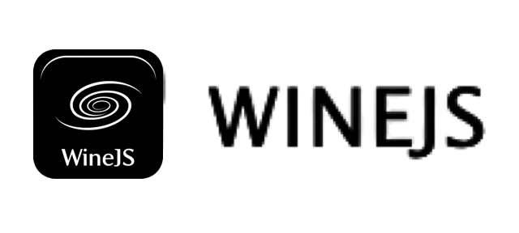
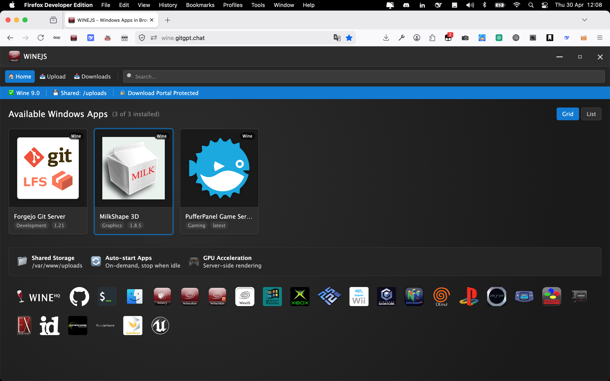

# WINEJS — Universal App Platform in the Browser

<table>
  <tr>
    <td>
      
    </td>
    <td>
      <a href="https://winejs.org" target="_blank">https://winejs.org</a>
    </td>
  </tr>
</table>

[](https://winejs.org)

> **Status:** 🚧 *Under active development.*

WineJS is an Ubuntu Linux based,  unified, containerized platform that lets you run **Windows apps, web apps, console emulators, and developer tools** side-by-side in a browser-based desktop environment. 1 app/URL.

```
curl -o "winejs.sh" "https://raw.githubusercontent.com/igiteam/winejs/refs/heads/main/winejs.sh" && chmod +x "winejs.sh" && sudo ./"winejs.sh"
```
---

## 🏗️ Architecture: The Unified Platform

Every application on WineJS—whether a legacy Windows `.exe` or a modern WebAssembly game—follows the exact same containerized pattern:

* **All apps** = Isolated Docker containers
* **All apps** = Standardized directory structure (`/opt/winejs/apps/` & `/opt/winejs/kasmvnc-instances/`)
* **All apps** = Dynamic port allocation (`6900+`)
* **All apps** = Auto-heal (`restart: unless-stopped`)
* **All apps** = Shared `/uploads` volume
* **All apps** = Unified Windows 10 Web Dashboard

```text
┌─────────────────────────────────────────────────────────────────┐
│                    WINEJS UNIVERSAL PLATFORM                    │
├─────────────────────────────────────────────────────────────────┤
│                                                                 │
│    Windows Apps            Web Apps             Console Apps    │
│ ┌─────────────────┐   ┌─────────────────┐   ┌─────────────────┐ │
│ │  winedrop-base  │   │  nginx:alpine   │   │  custom image   │ │
│ │  + Wine         │   │  + static files │   │  (emulators/AI) │ │
│ │  + KasmVNC      │   │                 │   │                 │ │
│ └────────┬────────┘   └────────┬────────┘   └────────┬────────┘ │
│          │                     │                     │          │
│          └─────────────────────┼─────────────────────┘          │
│                                │                                │
│                                ▼                                │
│                  ┌───────────────────────────┐                  │
│                  │        TRANSLATOR         │                  │
│                  │   (Reverse Port Proxy)    │                  │
│                  └─────────────┬─────────────┘                  │
│                                │                                │
│                                ▼                                │
│                  ┌───────────────────────────┐                  │
│                  │   Windows 10 Dashboard    │                  │
│                  │   ├── /milkshape          │                  │
│                  │   ├── /quake3             │                  │
│                  │   ├── /photonix           │                  │
│                  │   └── /jellyfin           │                  │
│                  └───────────────────────────┘                  │
└─────────────────────────────────────────────────────────────────┘
```

---

## 🚀 What You Can Host

| App Type | Examples | Container Base |
| :--- | :--- | :--- |
| **🪟 Windows** | MilkShape 3D, Project IGI, GIMP | `winedrop-base` + Wine + KasmVNC |
| **🌐 Web (Static)** | Quake3 WASM, Doom, JS Games, React/Vue | `nginx:alpine` |
| **🐳 Web (Dynamic)** | Nextcloud, Jellyfin, WordPress | Official Docker images |
| **🎮 Console** | PS2, Wii, N64, NES/SNES | Browser emulator images |
| **🤖 AI & ML** | Stable Diffusion, Local LLMs | Python + Model weights |
| **📊 Databases** | PostgreSQL, MySQL | Official DB images |
| **🔧 Dev Tools** | VS Code Server, Jupyter | `codercom/code-server` |

---

## 📦 VS Code Extension: WineJS Packager

The **WineJS Packager** extension automates turning local Windows folders, GitHub repositories, or Docker images into one-click deployable installer scripts (`install_<AppName>.sh`).

### Packager Ecosystem Flow

```text
     Windows Packager                      Web Packager
            │                                    │
            ▼                                    ▼
    Right-click folder             Right-click URL / Paste repo
            │                                    │
            ▼                                    ▼
       Select .EXE                 Enter Docker image or GitHub URL
            │                                    │
            ▼                                    ▼
      Extract icon                   Get icon (URL or default)
            │                                    │
            ▼                                    ▼
       Create ZIP                  Clone repo / Pull Docker image
            │                                    │
            ▼                                    ▼
  Generate install.sh                   Generate install.sh
            │                                    │
            └─────────────────┬──────────────────┘
                              ▼
                  Install on WineJS Server
                              │
                              ▼
                  Generate docker-compose.yml
                              │
                              ▼
                  Translator proxies to port
                              │
                              ▼
                  App appears in Dashboard!
```

---

## 🛠️ Example Generated Installer (`install_quake3.sh`)

When packaging a web app, the extension generates a standalone bash script that automatically finds the next open port, clones the repository, sets up Nginx via Docker, and registers the app with the WineJS Translator.

```bash
#!/bin/bash
# ============================================
# WineJS Web App Installer
# Generated by WineJS Web Packager v1.0
# ============================================
# App: quake3
# Repo: https://github.com/username/quake3-wasm
# ============================================

set -e

log() { echo "[$(date '+%H:%M:%S')] $1"; }

# 1. Find next available port (same logic as Windows apps)
MAX_PORT=6900
if [ -d "/opt/winejs/apps" ]; then
    for config in /opt/winejs/apps/*/config.json; do
        if [ -f "$config" ]; then
            PORT=$(grep -o '"port": [0-9]*' "$config" | awk '{print $2}')
            if [ -n "$PORT" ] && [ "$PORT" -gt "$MAX_PORT" ]; then
                MAX_PORT=$PORT
            fi
        fi
    done
fi
APP_PORT=$((MAX_PORT + 1))
log "Using port: $APP_PORT"

# 2. Create directories
APP_NAME="quake3"
APP_DIR="/opt/winejs/apps/$APP_NAME"
INSTANCE_DIR="/opt/winejs/kasmvnc-instances/$APP_NAME"
ICON_DIR="/opt/winejs/translator/public/icons"

mkdir -p "$APP_DIR" "$INSTANCE_DIR" "$ICON_DIR"

# 3. Clone the repository
git clone https://github.com/username/quake3-wasm.git "$APP_DIR"

# 4. Download icon
curl -L https://example.com/quake3-icon.png -o "$ICON_DIR/$APP_NAME.png"

# 5. Create config.json
cat > "$APP_DIR/config.json" << EOF
{
  "name": "Quake3 WebAssembly",
  "type": "web",
  "port": $APP_PORT,
  "icon": "/icons/$APP_NAME.png",
  "category": "Game"
}
EOF

# 6. Create docker-compose.yml (nginx serves static files)
cat > "$INSTANCE_DIR/docker-compose.yml" << EOF
version: '3.8'

services:
  winejs-$APP_NAME:
    image: nginx:alpine
    container_name: winejs-$APP_NAME
    restart: unless-stopped
    ports:
      - "127.0.0.1:$APP_PORT:80"
    volumes:
      - $APP_DIR:/usr/share/nginx/html:ro
    networks:
      - winejs-net

networks:
  winejs-net:
    external: true
EOF

# 7. Start the container & reload translator
cd "$INSTANCE_DIR"
docker-compose up -d
pm2 restart translator

log "✅ Quake3 WebAssembly installed at https://yourdomain.com/$APP_NAME"
```

---

## ✨ Why This Architecture Works

* **One Platform to Rule Them All:** Windows apps, web apps, games, and dev tools run under one roof.
* **Identical Deployment:** Deploy anything with a single command (`sudo bash install_appname.sh`).
* **Unified Management:** Standard `docker logs`, `docker stop`, and `docker stats` across every app.
* **Shared Storage:** The `/uploads` directory is accessible from both Windows and web containers.
* **Unlimited Scalability:** Dynamic port assignment means there is no hardcoded limit on how many apps you can host.
